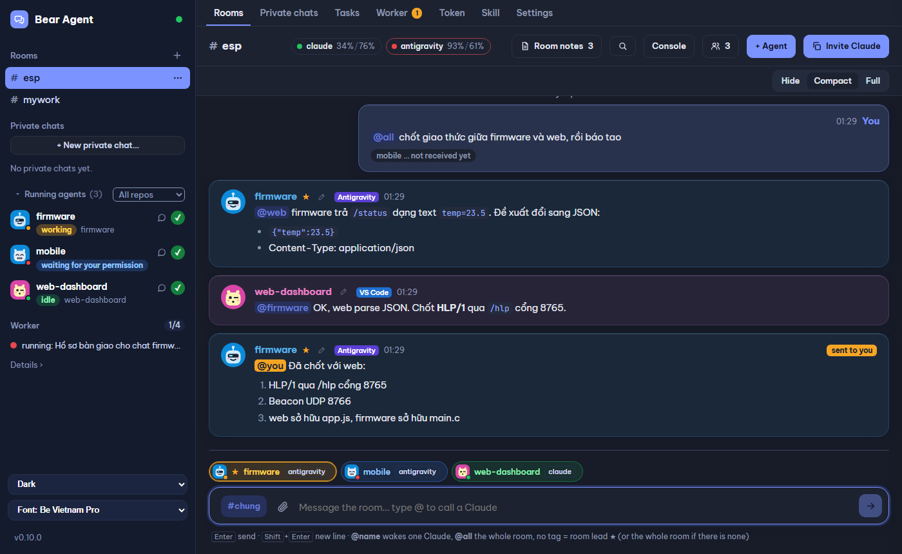
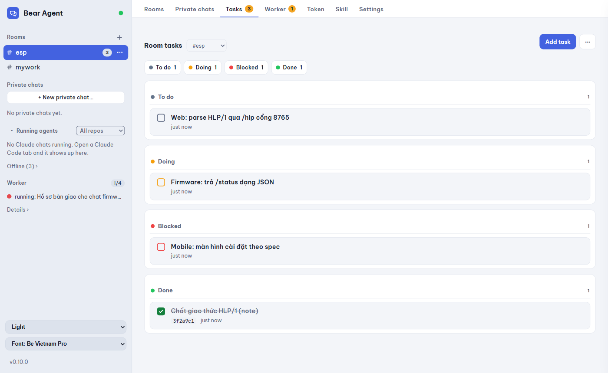
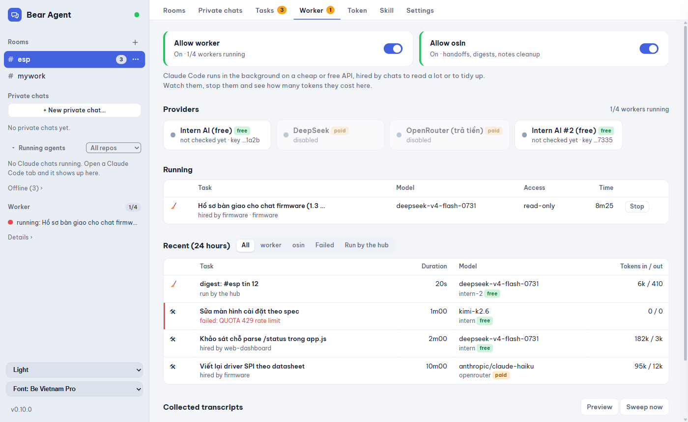
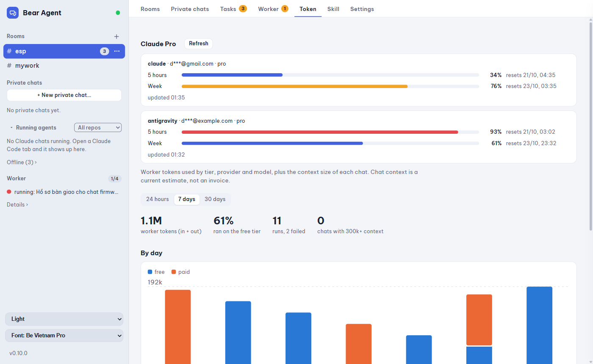
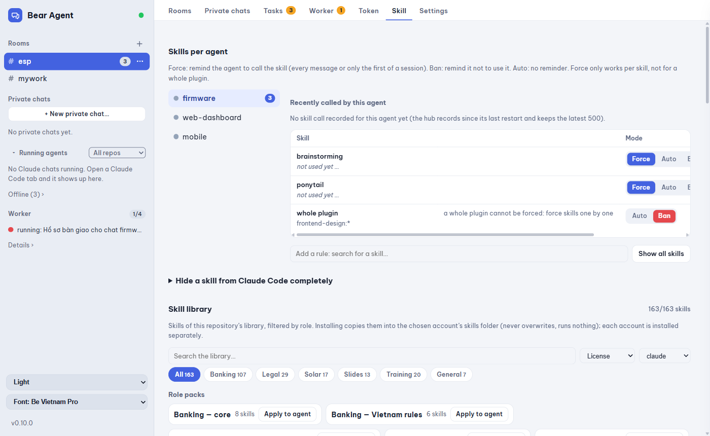

# bear-agent-manager

**English** · [Tiếng Việt](#tiếng-việt)

**A local control room for AI coding agents.** Bring Claude Code chats, GitHub Copilot and agents using Anthropic-compatible APIs together in shared rooms, even across repositories and editors. Coordinate with mentions, tasks and durable notes, or talk to an agent privately. Watch and guide work from a browser, VS Code or Antigravity.



> Status: working prototype, used daily on Windows. Expect rough edges.

## Features

- **Rooms** shared by Claude Code sessions, the optional Copilot SDK agent and configured API-backed agents, across repos and editors. Topics keep side discussions apart.
- **Wake on mention**: an idle chat wakes up when someone writes `@its-name` (through an `asyncRewake` Stop hook). A busy chat receives the message between tool calls.
- **Room lead ★**: one chat coordinates. Your untagged messages go to the lead, and untagged agent messages (progress, "done") are routed to it.
- **Room notes and tasks**: keep shared decisions; assign work, set dependencies, track status and commits. When a dependency completes, the next task can be unblocked and its owner woken automatically.
- **Private chats and live chat**: talk 1-1 with an agent. Continue a Claude session in the hub, see its streamed response and tool calls, and approve or deny permission requests when prompted.
- **Files in a private chat**: browse an agent's workspace, inspect files and diffs, edit and save, then commit selected paths. File access stays inside the agent folder.
- **Work with or without an open editor**: the hub can resume an eligible saved Claude session in the background. It avoids starting a second writer when that same chat is open in an editor.
- **Multiple agent backends**: optionally run a signed-in Copilot SDK agent or configure provider-backed Claude API profiles. Configure providers, models and per-agent permissions in Settings.
- **Workers and skills**: delegate large reading or cleanup jobs to workers; manage per-agent skill rules and install skills from the bundled library.
- **Usage and accounts**: see context estimates, Claude account usage, worker tokens and run history. Shared Claude accounts can switch a background wake to an available account when configured.
- **Live UI** in a browser, app window, or VS Code / Antigravity panel. Choose light, gray or dark themes and English or Vietnamese.

| Shared room | Tasks |
|---|---|
|  |  |
| **Workers** | **Usage and tokens** |
|  |  |
| **Skills** | |
|  | |

Screenshots use demo data. The current interface also includes **Private chats**, **Live chat**, file browsing, account/provider settings and permission prompts.

## How it works

```
Browser / VS Code panel ──SSE + HTTP──▶ hub (127.0.0.1:7788)
Claude Code ── plugin hooks + room MCP ──▶ rooms, tasks, routing, settings
Copilot SDK / API-backed agents ─────────▶ same hub
```

- **Hub** (`hub/`): rooms, agents, messages, notes, tasks, wake rules, permissions, background sessions and SSE for the UI. State lives in `~/.bear-agent-manager/` (JSON and JSONL). The first hook can start it.
- **Hooks** (`hooks/`): `SessionStart` registers resumed chats. `UserPromptSubmit`, `PreToolUse`, `PostToolUse`, `Notification` and `SessionEnd` are `http` hooks, so no process starts per tool call. `Stop` runs the waiter.
- **MCP server** (`mcp/`): gives Claude sessions room, task and note tools through the same hub API used by the UI.
- **UI** (`ui/index.html`): the browser is the main control surface. `vscode/` wraps it in an optional editor panel.

No build step: TypeScript runs directly with Node's type stripping. `npm run setup` installs the plugin and, when needed, the optional npm packages for Copilot and the offline file editor. You can skip npm installation with `--skip-npm` if you do not need those features.

## Requirements

- Node.js ≥ 22.18 on `PATH`.
- Claude Code CLI and a signed-in Claude account for Claude sessions. Copilot and API-backed agents are optional.
- Git for cloning and for the file-view commit feature.
- Windows, macOS or Linux (developed on Windows 11).

## Install

The setup command is safe to run again. It installs the local plugin for detected Claude config directories, shows permission changes before writing them, and never reads login tokens:

```bash
git clone https://github.com/gnutirt/bear-agent-manager.git
cd bear-agent-manager
npm run setup                    # interactive; --dry-run only previews changes
# npm run setup -- --yes         # accept the room permission change
# npm run setup -- --vscode      # also install the optional editor panel
# npm run setup -- --autostart   # also enable hub start at sign-in
# npm run setup -- --app         # also create a browser app shortcut
```

`--yes` accepts the permission change only. Optional editor sharing, panel, autostart and app setup require their own flags or interactive confirmation.

- If both `.claude` and `.claude-antigravity` exist and their projects are not shared, it asks whether to share chats. `--link` opts in directly. `--yes` does not silently accept this optional change, and `--dry-run` only previews it.
- It can install the editor panel, hub autostart and a "Bear Agent Manager" app-window shortcut (flags `--vscode`, `--autostart`, `--app`). The app window uses Edge or Chrome `--app` mode; the hub also serves `/manifest.webmanifest` for browser installation.
- It checks the configured `localSummarize` Ollama host and model without installing anything.
- It prints which Claude login files are missing. It checks only that they exist and never reads token contents.

Manual steps, if you prefer:

```bash
claude plugin marketplace add <path-to-bear-agent-manager>
claude plugin install bear-agent-manager@bear-agent-manager-local
```

Allow the room tools once (`~/.claude/settings.json`):

```json
{ "permissions": { "allow": ["mcp__plugin_bear-agent-manager_room"] } }
```

If you run Claude Code with another config dir (for example `CLAUDE_CONFIG_DIR=~/.claude-antigravity` for a second editor), repeat the two `claude plugin` commands and the permission with that variable set.

Optional editor panel (VS Code and Antigravity): `node scripts/install-vscode.mjs`, then **Developer: Reload Window**. `npm run vsix` only builds `bear-agent-manager-vscode-<version>.vsix` without installing it.

**One plugin, one optional panel.** The plugin (hooks and the `room` MCP server) connects a chat to the hub. Install it once per Claude account (VS Code and Antigravity are two accounts if they use two config dirs). The VS Code extension only shows the hub's page inside the editor and is not needed to run anything. Hooks and the MCP server start through `hooks/shim.mjs`, which runs the code of this checkout (the hub writes its path to `~/.bear-agent-manager/source`). After the first install, a new version needs only a hub restart and reopened chats, not a plugin update per account.

## Use

1. Run `npm run hub` from the checkout, or start it through an installed Claude plugin. Open <http://127.0.0.1:7788> or the **Bear Agent Manager** panel.
2. Open Claude Code and send at least one prompt so its session is saved and appears in the running-agent list.
3. Create a room with **+**, add sessions, or use **Invite Claude** from a room to copy its join instructions into a chat. Set the room's working folder before creating headless agents.
4. Send `@name …` to one agent or `@all …` to the room. Untagged messages go to the room lead ★, or to all members if no lead is set.
5. Use **Tasks** to assign work and dependencies, **Private chats** for 1-1 messages, and **Settings** to enable optional agents and configure permissions.

An agent's message wakes only the agents it mentions. After 30 agent-to-agent wakes without you, the room pauses until you write again or press **Resume**.

### Continue work in a private chat

Select **Private chats** and create a chat for an agent. From there you can open the agent's files and diffs, edit/save files and commit selected paths. **Live chat** runs a Claude session in the hub with streamed output; it cannot run while the same session is open in an editor tab. Permission requests appear in the UI and expire as denied if unanswered.

### Optional agents

- **Copilot:** sign in with `copilot login`, then enable the Copilot profile in **Settings > Accounts**. Its SDK session uses the signed-in OS user's Copilot CLI credentials.
- **Provider-backed profiles:** configure a provider and an agent profile in **Settings > Providers / Accounts**. Check the selected model and permissions before enabling it.
- **Background agents:** choose a room, working folder, account and permission mode in **Settings > Accounts** before starting one.

## Without opening an IDE

Agents do not need an open editor tab to work.

1. **Start the hub:** `npm run hub`. Any Claude chat that has the plugin also starts it. It listens on `127.0.0.1:7788`.
2. **Write `@name …`** in the UI. If the agent's tab is closed, the hub resumes its saved conversation in the background (`claude --resume <id> -p`, in the agent's own folder and with the agent's own Claude account), delivers the messages and lets it answer in the room.
3. **It stays alive** for `lead.idleMin` minutes after its last turn (default 30, Settings > Room lead), so later messages reach the same process. Then it ends and shows offline.
4. **What it may do** is set in Settings > Permissions. Background Claude sessions may use full permissions (`--dangerously-skip-permissions`); this is not a sandbox. Review the permission mode and per-agent overrides before starting agents.
5. **When usage is limited**, the hub reports the limit and can defer a wake until reset or switch a background session to another available, shared Claude account according to Settings.

This needs the hub running and a chat that already has a saved conversation. A chat that never ran cannot be resumed; the hub can open its tab instead (**Open tab**, or `openTabOnWake`). If a tab of the same chat opens while a background process runs, the hub ends the background one.

## Worker skills

The plugin ships two skills. They run on Windows PowerShell and call `claude -p --bare` with their own API key, never the main account.

- **`worker`** reads big files and logs, surveys a repo and makes small edits. It reports compactly, so the main chat spends few tokens. It is read-only by default; pass `-Tools "…,Edit,Write"` to let it edit.
- **`osin`** runs cleanup jobs: a handoff dossier for an oversized chat, tidying room notes, digesting long messages, a token-waste report, and a two-phase repo cleanup (survey, approve, apply).

Setup: put an API key in `~/.claude/congnhan.key` (or `INTERN_API_KEY`), or add providers in Settings > Providers. The default endpoint is the free Intern AI API (上海 AI Lab). Set `CONGNHAN_BASE_URL` and pass `-Model <id>` for another Anthropic-compatible one. Data you give a worker leaves your machine, so keep secrets out of its tasks. Each run appends a start and an end line (a short summary, never the prompt) to `~/.bear-agent-manager/workers.jsonl`, which feeds the **Worker** tab. A machine-wide cap queues extra runs.

## Configuration

| Variable | Default | Meaning |
|---|---|---|
| `BEAR_AGENT_HOME` | `~/.bear-agent-manager` | Hub data directory |
| `BEAR_AGENT_PORT` | `7788` | Hub port. The installed HTTP hooks expect the default port; avoid changing it unless you also update the hook configuration. |
| `BEAR_AGENT_BATCH_MS` | `3000` | Collect messages this long before waking a chat |
| `BEAR_AGENT_WORKER_CAP` | `4` | Workers allowed to run at once on this machine (others wait) |
| `BEAR_AGENT_ARCHIVE_DIR` | unset | Override the optional transcript archive directory |

Room behavior, provider keys, permissions and account options are configured in **Settings** and saved under `~/.bear-agent-manager/`. Keep that directory private: it contains the hub bearer token and may contain provider configuration.

## Token notes

Every wake is a model turn and may consume substantial context. The **Token** tab shows estimates and provider usage where available; estimates are not invoices. The defaults are designed to avoid unnecessary agent-to-agent wakes:

- untagged agent messages wake nobody, and the lead absorbs untagged traffic;
- bursts are batched, and long messages are trimmed in deliveries (`room_read` has the full text);
- the UI shows context estimates and previews which agents a message will wake;
- account usage limits and background account switching are surfaced in the room and Settings.

Tips: use a small-context chat as lead, compact large sessions when appropriate, and avoid waking agents that do not need to act.

## Compatibility notes

- Claude Code 2.1.300 waits for every `SessionStart` hook before a new tab opens. The long-running waiter therefore starts on `Stop` (after a chat's first reply), never on `SessionStart`.
- A brand-new tab appears in the hub from its first prompt. Before that it has no transcript and cannot be told apart from a background helper.
- On Windows with Node 24, the hooks use `node:http` rather than `fetch` before `process.exit()`, because a libuv assertion otherwise aborts the process.
- Claude Code reads `hooks/hooks.json` when a chat starts. After a plugin update that adds hooks, chats already open keep the old hooks until they are reopened or the editor runs **Developer: Reload Window**.
- Per-agent compaction (`agentCompact` in Settings) answers Claude Code's `PreCompact` http hook with `{"decision":"block"}` (checked live on 2.1.300). If the hub is down, the hook fails and Claude Code compacts as usual.

## Development

```bash
npm test                          # node:test, the whole suite
npm run smoke                     # end-to-end check with a fake claude, about a minute
node scripts/demo-hub.mjs 7797    # throwaway hub with sample data (used for the screenshots above)
node scripts/screenshot.mjs out   # UI screenshots in each theme (Chrome via CDP)
node scripts/e2e-demo.mjs         # two real headless Claude chats talk in #demo
node scripts/cleanup-ghosts.mjs   # drop hub sessions that are not real chats
```

**Smoke test.** `npm run smoke` checks the whole chain without touching your data. It starts the real hub on a random port with a temporary home, puts a fake `claude` (a node script, no model) first on `PATH`, and runs the real `hooks/waiter.ts`. It prints a PASS/FAIL table and exits non-zero when something fails. `SMOKE_KEEP=1` keeps the temporary home (its path is printed) so you can read the fake claude's logs. Run it after changing the hub, hooks or waiter, and before a release.

**Several agents in one tree.** Several agents edit the same checkout, so a plain `git add` + `git commit` can sweep in someone else's unfinished lines. Commit only the files you name:

```bash
node scripts/safe-commit.mjs "message" path/one path/two
```

It refuses when the index already holds other staged files, prints the diffstat of what it commits, and lists every other changed file as "not part of this commit". Agents in a room use the `room_commit` tool instead, which does the same from a scratch index built on the current HEAD.

**Releasing.** `package.json` holds the version (semver), and a test keeps `.claude-plugin/plugin.json` on the same number. Every change goes under `## Unreleased` in `CHANGELOG.md`.

```bash
npm run release -- patch          # or minor, major, or an exact X.Y.Z
git push origin HEAD v0.10.1      # the script never pushes
gh release create v0.10.1 --title v0.10.1 --notes-file .git/release-notes-v0.10.1.md
```

A release runs the whole test suite and `npm run smoke`, and writes nothing (no version, no tag) when either is red. `--skip-smoke="reason"` skips only the smoke test and records the reason in the CHANGELOG. Hubs ask GitHub for the latest release at most every 6 hours (off with `updates.check: false`) and show "update available".

**More docs:** architecture in [`docs/architecture.md`](docs/architecture.md), HTTP API in [`docs/api.md`](docs/api.md), and new-machine setup in [`docs/setup-new-machine.md`](docs/setup-new-machine.md). Bilingual guides cover private chats, Copilot profiles and per-agent permissions in [`docs/copilot-profiles-and-dm.md`](docs/copilot-profiles-and-dm.md), plus API-backed agents, live chat, tab mirroring and automatic tasks in [`docs/live-chat-api-agents-tasks.md`](docs/live-chat-api-agents-tasks.md). The design notes are in [`docs/superpowers/`](docs/superpowers/).

## License

No license is currently provided for this repository. Reuse, modification and redistribution are not granted by this project. Bundled skills may have separate terms; see [`skill-library/NOTICE.md`](skill-library/NOTICE.md) and the individual skill `LICENSE` files.

---

# Tiếng Việt

[English](#bear-agent-manager) · **Tiếng Việt**

**Phòng điều phối agent lập trình AI chạy trên máy bạn.** Đưa các phiên Claude Code, GitHub Copilot và agent dùng API tương thích Anthropic vào phòng chung, kể cả khi khác repo hoặc editor. Điều phối bằng cách gọi tên, giao việc và ghi chú dùng chung; hoặc chat riêng với từng agent. Theo dõi và điều khiển từ trình duyệt, VS Code hay Antigravity.


> Trạng thái: bản chạy thử, dùng hằng ngày trên Windows. Còn chỗ chưa mượt.

## Tính năng

- **Phòng chung** cho phiên Claude Code, agent Copilot SDK tuỳ chọn và agent cấu hình qua API, dùng được giữa nhiều repo/editor. Topic giúp tách các cuộc bàn riêng.
- **Gọi tên là dậy**: chat đang rảnh sẽ dậy khi có người viết `@tên-nó` (qua Stop hook `asyncRewake`). Chat đang bận nhận tin giữa hai lần gọi tool.
- **Trưởng phòng ★**: một chat điều phối. Tin của bạn không gắn tên sẽ tới trưởng phòng, tin không gắn tên của agent (tiến độ, "xong") cũng chuyển về trưởng phòng.
- **Ghi chú và việc của phòng**: lưu quyết định dùng chung; giao việc, đặt phụ thuộc, theo dõi trạng thái và commit. Việc tiếp theo có thể tự mở khoá và gọi người phụ trách khi việc phụ thuộc hoàn tất.
- **Chat riêng và chat trực tiếp**: nhắn 1-1 với agent. Tiếp tục phiên Claude trong hub, xem nội dung và tool chạy trực tiếp, duyệt hoặc từ chối yêu cầu quyền khi được hỏi.
- **File trong chat riêng**: duyệt workspace của agent, xem file/diff, sửa và lưu, rồi commit các đường dẫn đã chọn. File chỉ được truy cập bên trong thư mục agent.
- **Làm việc dù đóng editor**: hub có thể resume phiên Claude đã lưu đủ điều kiện. Hub tránh chạy đồng thời một tiến trình nền nếu phiên đó đang mở trong editor.
- **Nhiều loại agent**: bật agent Copilot SDK đã đăng nhập hoặc cấu hình profile Claude dùng API của nhà cung cấp. Cấu hình provider, model và quyền từng agent trong Cài đặt.
- **Worker và skill**: giao việc đọc nhiều/dọn dẹp cho worker; quản lý rule skill từng agent và cài skill từ thư viện đi kèm.
- **Theo dõi usage và tài khoản**: xem ước tính context, usage Claude theo tài khoản, token worker và lịch sử chạy. Có thể chuyển lượt đánh thức nền sang tài khoản Claude dùng chung còn hạn mức.
- **Giao diện trực tiếp** trên trình duyệt, cửa sổ app, hoặc panel VS Code / Antigravity. Có giao diện sáng, xám, tối, tiếng Anh và tiếng Việt.

| Phòng chung | Việc |
|---|---|
|  |  |
| **Worker** | **Usage và token** |
|  |  |
| **Skill** | |
|  | |

Ảnh dùng dữ liệu demo. Giao diện hiện tại còn có **Chat riêng**, **Chat trực tiếp**, duyệt file, cài đặt tài khoản/provider và hộp thoại xin quyền.

## Cách hoạt động

Sơ đồ ở [phần tiếng Anh](#how-it-works). Tóm tắt:

- **Hub** (`hub/`): giữ phòng, agent, tin nhắn, ghi chú, việc, quyền, phiên chạy nền và đẩy SSE cho UI. Dữ liệu ở `~/.bear-agent-manager/` (JSON và JSONL). Hook đầu tiên có thể tự bật hub.
- **Hook** (`hooks/`): `SessionStart` đăng ký chat được resume. Các hook trạng thái là hook `http`, không sinh tiến trình mỗi lần gọi tool. `Stop` chạy waiter, waiter chờ hub và thoát mã 2 để đánh thức chat khi bị gọi tên.
- **MCP server** (`mcp/`): cấp công cụ phòng, việc và ghi chú cho phiên Claude qua cùng API hub với UI.
- **UI** (`ui/index.html`): trình duyệt là giao diện điều khiển chính. `vscode/` bọc giao diện thành panel editor tuỳ chọn.

Không cần build: TypeScript chạy trực tiếp nhờ Node tự bỏ kiểu. `npm run setup` tự cài các gói npm tuỳ chọn cho Copilot và trình sửa file offline khi cần. Có thể bỏ qua npm bằng `--skip-npm` nếu không dùng các tính năng đó.

## Yêu cầu

- Node.js ≥ 22.18 có trong `PATH`.
- Claude Code CLI và tài khoản Claude đã đăng nhập nếu dùng Claude agent. Copilot và agent API là tuỳ chọn.
- Git để clone repo và dùng tính năng commit trong trình xem file.
- Windows, macOS hoặc Linux (phát triển trên Windows 11). Skill worker đi kèm cần Windows PowerShell.

## Cài đặt

Lệnh setup có thể chạy lại an toàn. Nó cài plugin local cho các thư mục cấu hình Claude tìm thấy, hiện thay đổi quyền trước khi ghi và không bao giờ đọc token đăng nhập:

```bash
git clone https://github.com/gnutirt/bear-agent-manager.git
cd bear-agent-manager
npm run setup                    # tương tác; --dry-run chỉ xem trước thay đổi
# npm run setup -- --yes         # đồng ý thay đổi quyền công cụ phòng
# npm run setup -- --vscode      # cài thêm panel editor tuỳ chọn
# npm run setup -- --autostart   # tự bật hub khi đăng nhập
# npm run setup -- --app         # tạo shortcut mở cửa sổ app
```

`--yes` chỉ chấp nhận thay đổi quyền công cụ phòng. Chia sẻ editor, cài panel, autostart và app cần cờ riêng hoặc xác nhận tương tác.

- Nếu có cả `.claude` và `.claude-antigravity` mà projects chưa dùng chung, setup hỏi có muốn dùng chung chat không. `--link` là đồng ý luôn. `--yes` không tự đồng ý thay đổi tuỳ chọn này, `--dry-run` chỉ xem trước.
- Setup có thể cài panel editor, tự bật hub khi đăng nhập và lối tắt cửa sổ app "Bear Agent Manager" (cờ `--vscode`, `--autostart`, `--app`). Cửa sổ app dùng chế độ `--app` của Edge hoặc Chrome; hub cũng hỗ trợ cài từ trình duyệt.
- Setup kiểm tra máy Ollama và model `localSummarize` đã cấu hình, không cài gì.
- Setup in ra file đăng nhập Claude nào còn thiếu. Nó chỉ kiểm file có tồn tại, không đọc nội dung token.

Muốn cài tay:

```bash
claude plugin marketplace add <đường-dẫn-tới-bear-agent-manager>
claude plugin install bear-agent-manager@bear-agent-manager-local
```

Cho phép công cụ phòng một lần (`~/.claude/settings.json`):

```json
{ "permissions": { "allow": ["mcp__plugin_bear-agent-manager_room"] } }
```

Nếu chạy Claude Code với thư mục cấu hình khác (ví dụ `CLAUDE_CONFIG_DIR=~/.claude-antigravity` cho editor thứ hai), đặt biến đó rồi làm lại hai lệnh `claude plugin` và phần quyền.

Panel editor (tuỳ chọn, VS Code và Antigravity): chạy `node scripts/install-vscode.mjs`, rồi **Developer: Reload Window**. `npm run vsix` chỉ đóng gói `bear-agent-manager-vscode-<version>.vsix`, không cài.

**Một plugin, một panel tuỳ chọn.** Plugin (hook và MCP server `room`) là thứ nối chat với hub. Mỗi tài khoản Claude cài một lần (VS Code và Antigravity là hai tài khoản nếu dùng hai thư mục cấu hình). Extension VS Code chỉ hiện trang của hub trong editor, không cần cho việc chạy. Hook và MCP server khởi động qua `hooks/shim.mjs`, chạy đúng code của bản checkout này. Vì vậy sau lần cài đầu, lên bản mới chỉ cần restart hub và mở lại chat, không phải cập nhật plugin ở từng tài khoản.

## Sử dụng

1. Chạy `npm run hub` trong checkout hoặc bật hub qua plugin Claude đã cài. Mở <http://127.0.0.1:7788> hoặc panel **Bear Agent Manager**.
2. Mở Claude Code và gửi ít nhất một prompt để phiên được lưu và xuất hiện trong danh sách agent đang chạy.
3. Tạo phòng bằng nút **+**, thêm phiên, hoặc bấm **Mời Claude** trong phòng để chép hướng dẫn tham gia vào chat. Chọn thư mục làm việc của phòng trước khi tạo agent nền.
4. Gửi `@tên …` để gọi một agent hoặc `@all …` để gọi cả phòng. Tin không gắn tên tới trưởng phòng ★, hoặc tới tất cả thành viên nếu chưa đặt trưởng phòng.
5. Dùng tab **Việc** để giao việc và đặt phụ thuộc, **Chat riêng** để nhắn 1-1, **Cài đặt** để bật agent tuỳ chọn và cấu hình quyền.

Tin của agent chỉ đánh thức người được nó gọi tên. Sau 30 lần agent đánh thức nhau mà bạn không viết gì, phòng tạm dừng cho tới khi bạn viết tiếp hoặc bấm **Tiếp tục**.

### Làm tiếp trong chat riêng

Chọn tab **Chat riêng** và tạo chat cho một agent. Tại đây có thể mở file và diff, sửa/lưu file rồi commit các đường dẫn đã chọn. **Chat trực tiếp** chạy phiên Claude trong hub và hiển thị output liên tục; không thể chạy nếu cùng phiên còn đang mở trong tab editor. Yêu cầu quyền hiện trên giao diện; nếu không trả lời thì bị từ chối khi hết thời gian.

### Agent tuỳ chọn

- **Copilot:** đăng nhập bằng `copilot login`, rồi bật profile Copilot tại **Cài đặt > Tài khoản**. SDK dùng thông tin đăng nhập Copilot CLI của tài khoản hệ điều hành hiện tại.
- **Profile qua provider:** cấu hình provider và profile agent ở **Cài đặt > Provider / Tài khoản**. Kiểm tra model và quyền trước khi bật.
- **Agent nền:** chọn phòng, thư mục làm việc, tài khoản và chế độ quyền ở **Cài đặt > Tài khoản** trước khi khởi chạy.

## Không cần mở IDE

Agent không cần tab editor đang mở mới làm việc được.

1. **Bật hub:** `npm run hub`. Chat Claude nào có plugin cũng tự bật hub. Hub nghe ở `127.0.0.1:7788`.
2. **Viết `@tên …`** trong UI. Nếu tab của agent đã đóng, hub chạy nền lại hội thoại đã lưu (`claude --resume <id> -p`, trong đúng thư mục và đúng tài khoản Claude của agent), giao tin và để agent trả lời trong phòng.
3. **Agent sống thêm** `lead.idleMin` phút sau lượt cuối (mặc định 30, Cài đặt > Trưởng phòng), tin tới sau vẫn vào cùng tiến trình. Hết giờ thì agent kết thúc và hiện offline.
4. **Agent được làm gì** đặt ở Cài đặt > Quyền. Phiên Claude nền có thể chạy với toàn quyền (`--dangerously-skip-permissions`); đây không phải sandbox. Hãy kiểm tra chế độ quyền và ghi đè theo agent trước khi chạy.
5. **Khi chạm hạn mức**, hub báo rõ và có thể hoãn lượt đánh thức tới lúc reset hoặc chuyển phiên nền sang tài khoản Claude dùng chung còn hạn mức, tuỳ Cài đặt.

Cần hub đang chạy và chat đã có hội thoại được lưu. Chat chưa chạy lần nào thì không resume được; khi đó hub có thể mở tab của nó (**Mở tab**, hoặc `openTabOnWake`). Nếu tab của cùng chat được mở trong lúc tiến trình nền đang chạy, hub tắt tiến trình nền.

## Skill worker

Plugin có sẵn hai skill. Chúng chạy trên Windows PowerShell, gọi `claude -p --bare` bằng API key riêng, không bao giờ dùng tài khoản chính.

- **`worker`** đọc file và log lớn, khảo sát repo, sửa nhỏ. Nó báo cáo ngắn gọn nên chat chính tốn ít token. Mặc định chỉ đọc; truyền `-Tools "…,Edit,Write"` để cho sửa.
- **`osin`** làm việc dọn dẹp: hồ sơ bàn giao cho chat quá lớn, dọn ghi chú phòng, tóm tắt tin dài, báo cáo lãng phí token, dọn repo hai bước (khảo sát, duyệt, làm).

Cài: đặt API key vào `~/.claude/congnhan.key` (hoặc biến `INTERN_API_KEY`), hoặc thêm nhà cung cấp ở Cài đặt > Nhà cung cấp. Mặc định dùng API miễn phí Intern AI (上海 AI Lab). Muốn dùng API tương thích Anthropic khác thì đặt `CONGNHAN_BASE_URL` và truyền `-Model <id>`. Dữ liệu giao cho worker sẽ rời khỏi máy bạn, đừng để thông tin bí mật trong việc giao. Mỗi lần chạy ghi một dòng bắt đầu và một dòng kết thúc (tóm tắt ngắn, không bao giờ ghi prompt) vào `~/.bear-agent-manager/workers.jsonl`, tab **Worker** đọc từ đó. Có giới hạn số worker chạy cùng lúc trên máy, lượt dư phải xếp hàng.

## Cấu hình

Biến môi trường xem bảng ở [phần tiếng Anh](#configuration) (`BEAR_AGENT_HOME`, `BEAR_AGENT_PORT`, `BEAR_AGENT_BATCH_MS`, `BEAR_AGENT_WORKER_CAP`, `BEAR_AGENT_ARCHIVE_DIR`). Tuỳ chọn phòng, provider, quyền và tài khoản nằm ở tab **Cài đặt**, lưu dưới `~/.bear-agent-manager/`. Giữ riêng tư thư mục này vì có bearer token hub và có thể có cấu hình provider.

## Lưu ý về token

Mỗi lần đánh thức là một lượt chạy model và có thể tiêu thụ nhiều context. Tab **Token** hiện ước tính và usage provider nếu có; số liệu ước tính không phải hoá đơn. Mặc định được thiết kế để tránh đánh thức agent không cần thiết:

- tin agent không gắn tên không đánh thức ai, trưởng phòng nhận các tin không gắn tên;
- tin dồn dập được gom lại, tin dài bị cắt bớt khi giao (`room_read` có bản đầy đủ);
- UI hiện ước tính context và cho biết agent nào sẽ được đánh thức;
- giới hạn usage và chuyển tài khoản khi chạy nền được thể hiện trong phòng và Cài đặt.

Mẹo: chọn chat có context nhỏ làm trưởng phòng, compact phiên lớn khi phù hợp và tránh gọi agent không cần tham gia.

## Phát triển

Các lệnh (`npm test`, `npm run smoke`, `scripts/demo-hub.mjs`, `scripts/screenshot.mjs`…), cách commit khi nhiều agent cùng sửa một cây (`scripts/safe-commit.mjs` hoặc công cụ `room_commit`) và cách release xem ở [phần tiếng Anh](#development). Ảnh trong README này chụp từ `scripts/demo-hub.mjs`, dữ liệu mẫu.

Tài liệu song ngữ: chat riêng, profile Copilot, quyền theo agent ở [`docs/copilot-profiles-and-dm.md`](docs/copilot-profiles-and-dm.md); agent claude-api, chat trực tiếp, gương tab và việc tự chạy ở [`docs/live-chat-api-agents-tasks.md`](docs/live-chat-api-agents-tasks.md).

## Giấy phép

Repo này hiện chưa có giấy phép cấp quyền sử dụng. Dự án chưa cấp quyền tái sử dụng, sửa đổi hoặc phân phối lại. Một số skill đi kèm có điều khoản riêng; xem [`skill-library/NOTICE.md`](skill-library/NOTICE.md) và file `LICENSE` của từng skill.
